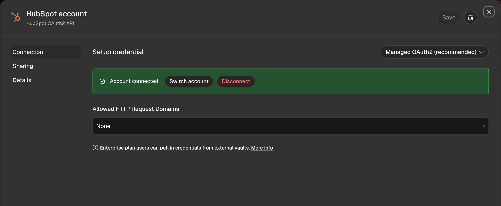
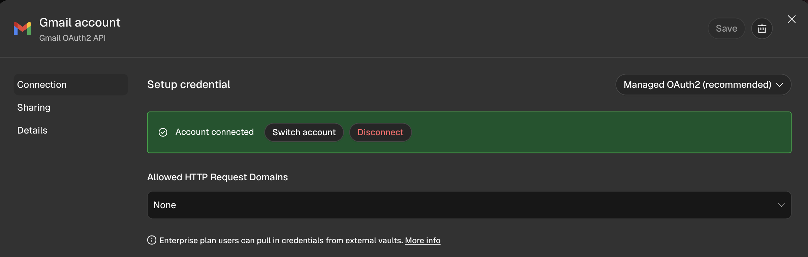
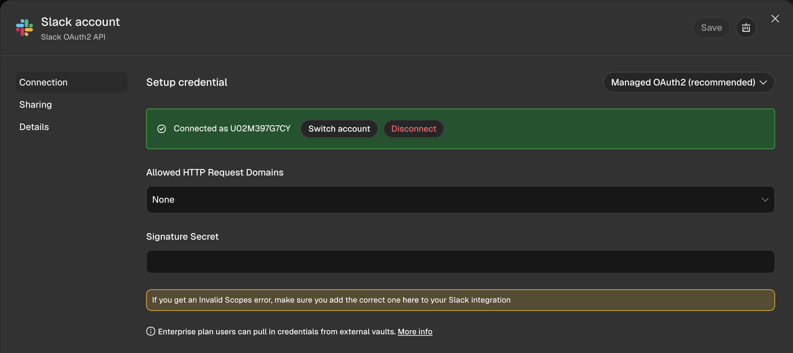

# TP4 — Tendencia Urbana

Alumno: Leandro Vildoza.

Evolución del TP3 en n8n: Manager y dos Workers, con memoria en Airtable, integración con HubSpot, Gmail y Slack mediante OAuth2.

## Archivos

- `checkpoint4_leandro_vildoza.json`: workflow principal (Manager).
- `M04 _ Worker 01 _ Consultar Disponibilidad.json`: consulta Google Calendar.
- `M04 _ Worker 02 _ Crear Reserva.json`: valida y crea reservas.

## Controles solicitados

- IF inmediatamente después de Gmail Trigger: bloquea correo propio, cabeceras de autorespuesta, asuntos Auto-reply / Out of office / Undeliverable y remitentes no-reply@.
- Set de entrada: conserva los campos necesarios, limpia HTML y excluye binarios. IF previo al CRM: exige email no vacío.
- HubSpot: búsqueda por email antes de las ramas de creación y actualización, evitando duplicados.
- Gmail: exclusivamente Create Draft como salida de correo; el envío requiere revisión y acción humana.
- Set previo a Slack: conserva email, asunto e identificador del borrador, excluyendo binarios.

## Credenciales conectadas

Las capturas muestran las tres conexiones Managed OAuth2 activas. Los secretos y tokens no se incluyen en los workflows exportados.

### HubSpot

### Gmail

### Slack

El workflow utiliza lectura y escritura de contactos, lectura de correo y creación de borradores, y publicación en el canal de operaciones. Las capturas de Managed OAuth2 no detallan los scopes concedidos; no se afirma una auditoría de permisos mínimos.

## Pruebas manuales realizadas en n8n

- Correo propio: se detiene en el primer IF.
- Contacto nuevo: toma la rama Crear; mismo email: toma Actualizar.
- Reserva: ejecuta Worker 02 y genera borrador y aviso en Slack.
- Disponibilidad: ejecuta Worker 01 y genera borrador y aviso.
- Datos faltantes: solicita la información mediante borrador y avisa en Slack.
- Webhook: responde disponibilidad y datos faltantes sin ejecutar Gmail ni Slack.
- Limpieza HTML: salida con siete campos y texto sin etiquetas HTML.

La copia de entrega incorpora el filtro explícito por asunto/no-reply, validación de email y Set previo a Slack. Estos últimos ajustes requieren repetir la ejecución manual en n8n antes de la entrega; no se presentan como probados.

## Importación

1. Importar los dos Workers y el Manager en n8n.
2. Seleccionar las credenciales propias de OpenAI, Airtable, Google Calendar, HubSpot, Gmail y Slack.
3. En el Manager, seleccionar los Workers importados en los dos nodos de ejecución de subworkflows: sus IDs pueden cambiar al importar en otra instancia.
4. Verificar base y tabla de Airtable, calendario, casilla y canal de Slack.
5. Ejecutar la regresión manual y descargar nuevamente el Manager como `checkpoint4_leandro_vildoza.json`.

El JSON principal contiene el Manager, no los nodos internos de los Workers; por eso se adjuntan ambos workflows como dependencias.
